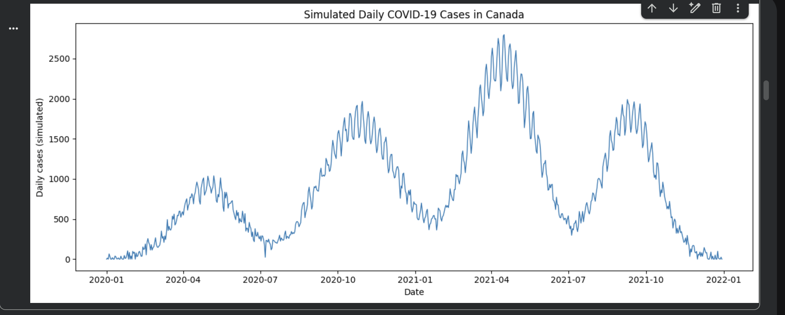
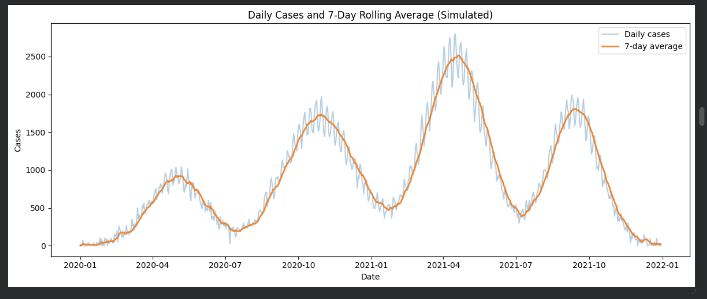
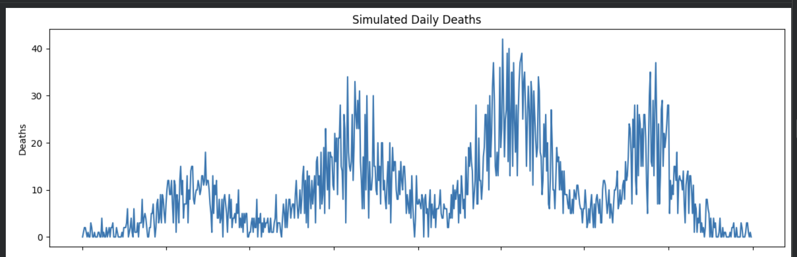
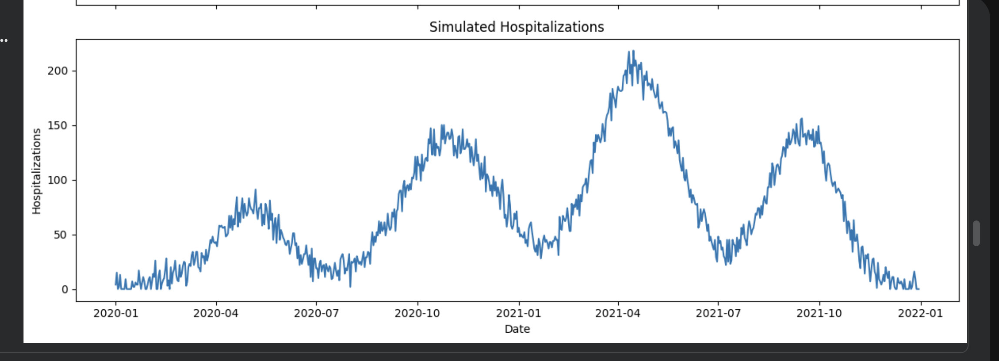
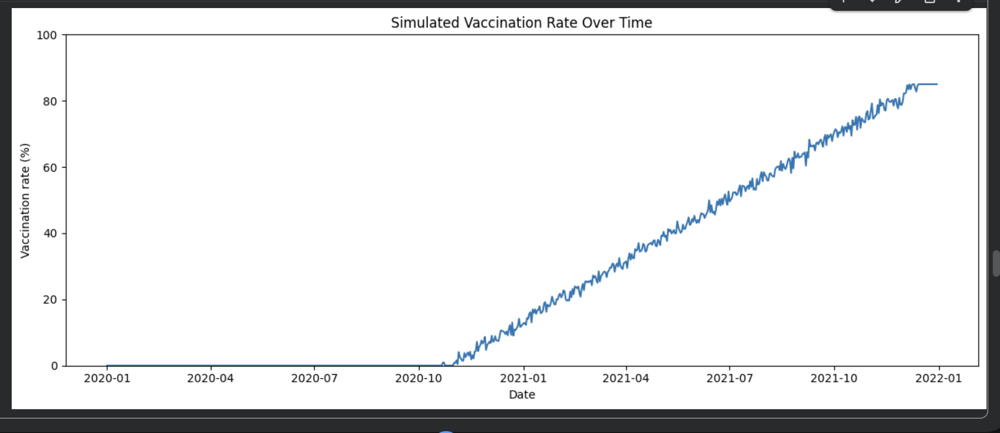
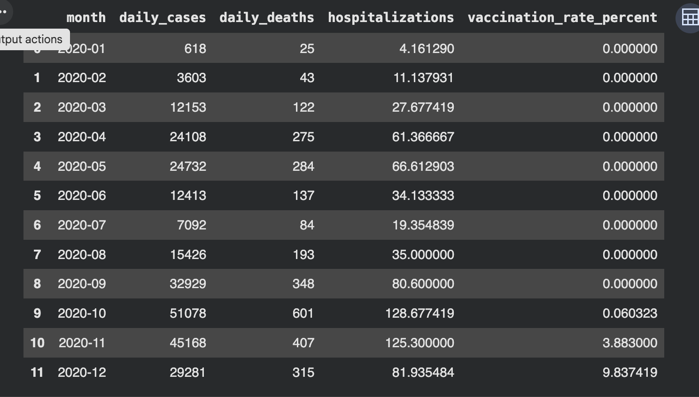
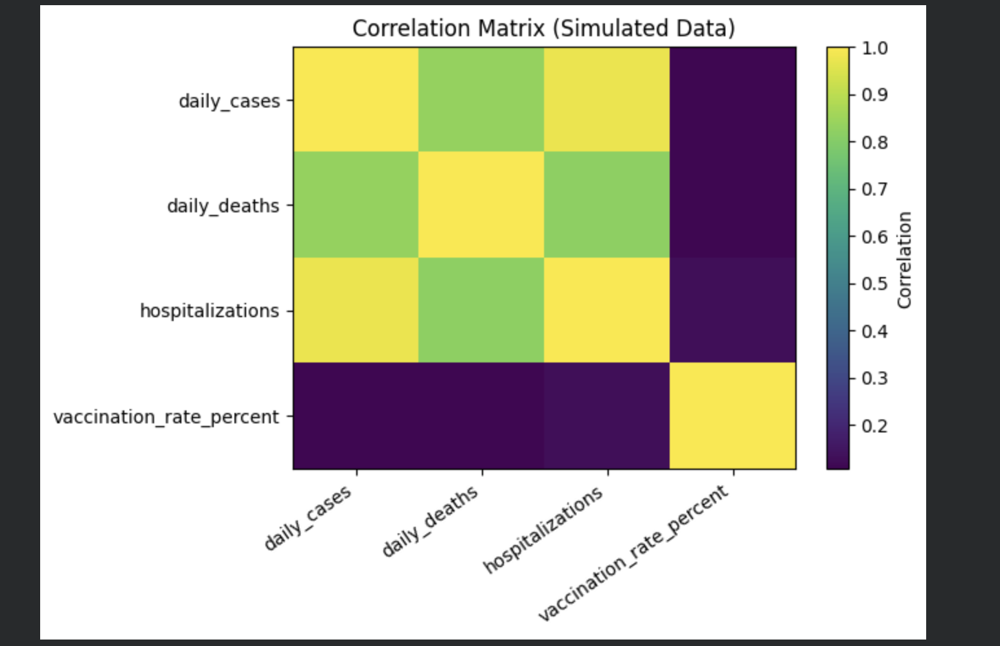

# COVID-19 Data Analysis (Canada)

A Python time-series and exploratory data analysis project examining simulated COVID-19 indicators over time.

## Dataset Information
`covid19_canada_simulated.csv` contains 730 daily rows with simulated cases, deaths, hospitalizations, and vaccination-rate values.

**Important:** This is synthetic practice data generated for this portfolio project. It is not official Canadian surveillance data and must not be represented as real COVID-19 statistics.

## Files
- `covid19_data_analysis.ipynb` — complete Jupyter Notebook
- `covid19_canada_simulated.csv` — simulated practice dataset
- `requirements.txt` — Python dependencies

## Technologies
Python, Pandas, NumPy, Matplotlib, Jupyter Notebook.

## Analysis Workflow
1. Load and inspect the time-series dataset.
2. Plot daily simulated cases.
3. Calculate and visualize a 7-day rolling average.
4. Explore simulated deaths and hospitalizations.
5. Visualize the vaccination-rate trend.
6. Calculate correlations among numeric indicators.
7. Create a monthly summary.

## Run Locally
```bash
pip install -r requirements.txt
jupyter notebook covid19_data_analysis.ipynb
```

Keep `covid19_canada_simulated.csv` in the same folder as the notebook, then run all cells.

## Results
Charts, correlation values, and monthly summaries are generated when the notebook is executed. Add observations based on your own run.

## Limitations
All values are simulated. This project is for learning data analysis techniques only and cannot support conclusions about real-world COVID-19 trends or public-health decisions.

## Data Visualizations

### 1. Daily COVID-19 Cases


### 2. 7-Day Rolling Average


### 3. Daily COVID-19 Deaths


### 4. COVID-19 Hospitalizations


### 5. Vaccination Trend


### 6. Monthly COVID-19 Summary


### 7. Cases and Deaths Correlation

